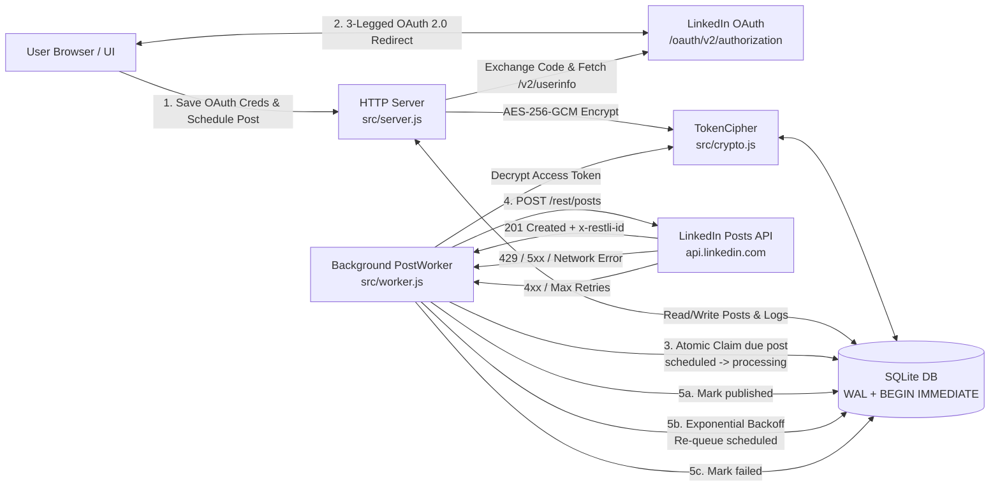

# LinkedIn Post Scheduler

A lightweight, self-contained Node.js application that connects to LinkedIn via **OAuth 2.0**, securely encrypts and stores access tokens in **SQLite**, schedules a LinkedIn post for a user-chosen date/time, and publishes it via a **background worker** with automatic exponential-backoff retries, structured logging, and multi-layer duplicate-post protection.

---

## Features

- **LinkedIn OAuth 2.0 (3-Legged Flow + OpenID Connect)**
  - Users enter their LinkedIn `Client ID`, `Client Secret`, and `Redirect URI` in the web UI (or pre-seed via `.env`).
  - CSRF `state` tokens stored in SQLite with a 10-minute TTL and one-time consumption.
  - Resolves member identity (`sub`, name, email) via `/v2/userinfo` to construct `urn:li:person:{sub}`.
- **Secure Token Storage**
  - OAuth `client_secret`, `access_token`, and `refresh_token` are encrypted at rest with **AES-256-GCM** (`v1:<iv>:<authTag>:<ciphertext>`) using unique random 96-bit IVs per write.
  - Decrypted tokens are never returned by API endpoints or written to logs.
- **Database-Backed Scheduling & Background Worker**
  - Built on Node's native `node:sqlite` (`WAL` mode, `BEGIN IMMEDIATE` write serialization).
  - Enforces the exact post lifecycle statuses: `scheduled`, `processing`, `published`, `failed`.
- **Automatic Retries with Increasing Delays**
  - Classifies LinkedIn API errors into **temporary** (`408`, `429`, `500`, `502`, `503`, `504`, network timeouts/resets) vs **permanent** (`400`, `401`, `403`, `404`, `422`).
  - Retries temporary errors automatically using exponential backoff (`baseDelayMs * 2^(attempt - 1)`, capped at `retryMaxDelayMs`) and honors larger `Retry-After` headers.
  - Attempts automatic OAuth token refresh on `401` or expiry when a `refresh_token` is present.
- **Multi-Layer Duplicate-Post Protection**
  1. **API Idempotency Key (`UNIQUE`)**: Prevents double-click or client retry duplicate inserts.
  2. **Content + Author Deduplication**: Computes normalized `SHA-256` `content_hash` and blocks scheduling duplicate content while an identical `scheduled`, `processing`, or `published` post exists for the same `author_urn`.
  3. **Atomic Worker Claiming**: Uses `UPDATE ... WHERE status = 'scheduled' AND next_attempt_at <= ? AND published_post_urn IS NULL` inside `BEGIN IMMEDIATE` so concurrent workers/ticks can never double-claim a post.
  4. **Crash-Lock Safety & LinkedIn `422` Handling**: Recovers stale `processing` locks as `failed` (`STALE_LOCK_INTERRUPTED`) rather than risking duplicate transmission, and detects LinkedIn `422` duplicate rejections without retrying.
- **Structured Redacting Logs**
  - Writes JSON logs to stdout, `.data/logs/app.log`, and SQLite `app_logs` (viewable in the UI), automatically scrubbing secrets and `Bearer` tokens.
- **Optional Local Sandbox Mode (`--mock`)**
  - Includes a local Mock LinkedIn OAuth & `/rest/posts` server (`LINKEDIN_MODE=mock`) with fault injection controls so you can test OAuth, increasing retry delays, and duplicate protection offline without a LinkedIn Developer App.

---

## Architecture Diagram



```text
+-------------------+       OAuth 2.0 / REST API       +------------------------+
|   Web UI (HTML)   | <------------------------------> |  HTTP Server (node)    |
+-------------------+                                  +-----------+------------+
                                                                   |
                                                       AES-256-GCM | SQLite WAL
                                                                   v
+-------------------+       Atomic Row Claim           +------------------------+
| Background Worker | <------------------------------> |   SQLite (.data/app.db)|
| (src/worker.js)   |   scheduled -> processing        | posts, post_attempts,  |
+---------+---------+   -> published / failed          | oauth_tokens, app_logs |
          |                                            +------------------------+
          | POST /rest/posts (Little Text escaped + X-Idempotency-Key)
          v
+-------------------+
|   LinkedIn API    |  (or MockLinkedInServer when LINKEDIN_MODE=mock)
+-------------------+
```

---

## Database Schema

The canonical SQL schema lives in [docs/schema.sql](docs/schema.sql) and is automatically applied on startup.

| Table | Purpose | Key Constraints / Notes |
| --- | --- | --- |
| `oauth_configs` | Stores user-entered `client_id`, `redirect_uri`, `scopes`, and encrypted `client_secret_encrypted`. | Singleton (`id = 1`). |
| `oauth_states` | Short-lived CSRF `state` tokens during OAuth redirect flow. | Consumed & deleted once on callback; expires automatically. |
| `oauth_tokens` | Connected `author_urn`, member profile metadata, and encrypted `access_token_encrypted` / `refresh_token_encrypted`. | Singleton (`id = 1`). |
| `posts` | Scheduled posts and execution state (`scheduled`, `processing`, `published`, `failed`). | `idempotency_key UNIQUE`, `published_post_urn UNIQUE`, indexed on `(status, next_attempt_at)` and `(author_urn, content_hash, status)`. |
| `post_attempts` | Immutable audit history of every publish attempt, HTTP status, retry delay, duration, and error. | Foreign key `post_id -> posts(id) ON DELETE CASCADE`. |
| `app_logs` | Queryable structured logs for the UI dashboard with secrets redacted. | Indexed on `created_at DESC`. |

### Post Status State Machine

```text
  [Create Post] ──► scheduled ──(due & atomically claimed)──► processing
                       ▲                                        │  │  │
                       │    temporary error (429/5xx/network)   │  │  │
                       └──────────(& attempts < max)────────────┘  │  │
                                                                   │  │
                              201 Created (x-restli-id saved) ─────┘  │
                                            │                         │ permanent error (4xx)
                                            ▼                         │ or max retries exhausted
                                        published                     ▼
                                                                    failed
```

---

## Setup Instructions

### Prerequisites

- **Node.js `v22.5.0` or higher** (uses built-in `node:sqlite`, `node:crypto`, `node:http`, and `fetch` — zero external npm packages required).

### 1. Configure LinkedIn Developer App (for Live Mode)

1. Open the [LinkedIn Developer Portal](https://developer.linkedin.com/) and create an app.
2. Under the **Products** tab, add:
   - **Sign In with LinkedIn using OpenID Connect** (`openid`, `profile` scopes)
   - **Share on LinkedIn** (`w_member_social` scope)
3. Under the **Auth** tab:
   - Copy your **Client ID** and **Client Secret**.
   - Add the Authorized Redirect URL: `http://localhost:3000/auth/linkedin/callback`

### 2. Configure Environment (`.env`)

Copy `.env.example` to `.env` (optional — defaults work out of the box, and OAuth credentials can also be entered directly in the UI):

```bash
cp .env.example .env
```

Recommended production setting in `.env`:

```env
PORT=3000
LINKEDIN_MODE=live
LINKEDIN_API_VERSION=202610
# Generate with: node -e "console.log(require('crypto').randomBytes(32).toString('hex'))"
TOKEN_ENCRYPTION_KEY=<64-hex-char-key>
```

> If `TOKEN_ENCRYPTION_KEY` is omitted during local development, a random 256-bit key is generated on first startup at `.data/.master.key` (gitignored).

### 3. Run the Application

**Live LinkedIn Mode (default):**

```bash
npm start
```

Open `http://localhost:3000` (or `http://127.0.0.1:3000`) in your browser:
1. Enter your LinkedIn `Client ID`, `Client Secret`, and `Redirect URI`, click **Save Credentials**, then **Connect with LinkedIn**.
2. Enter your post content, select visibility (`PUBLIC` or `CONNECTIONS`), pick a scheduled date/time, and click **Schedule Post**.
3. Leave the server running; the background worker picks up the post at the scheduled time, handles any temporary errors with increasing delays (`5s -> 10s -> 20s -> 40s`), and publishes it once.

**Local Mock Sandbox Mode (no LinkedIn Developer App required):**

```bash
npm run start:mock
```

1. Open `http://localhost:3000`.
2. Click **Fill Sandbox Creds** -> **Save Credentials** -> **Connect with LinkedIn** -> **Allow Access**.
3. Optionally configure **Sandbox Fault Simulator** (e.g., `2` temporary `503` errors before success).
4. Schedule a post (e.g., `+3 sec`) and watch the live **Scheduled Posts & Retry Tracker** and **Worker & API Logs** execute the retries with increasing delays and publish exactly one post.

### 4. Run Automated Tests

```bash
npm test
```

The test suite runs unit tests (`TokenCipher`, Little Text escaping, retry backoff math, secret redaction) and end-to-end HTTP + SQLite + Worker tests covering OAuth state CSRF checks, encrypted token persistence, temporary error backoff retries with zero duplicates, permanent failure handling, concurrent worker locking, and token refresh.

---

## REST API Summary

| Method | Path | Description |
| --- | --- | --- |
| `GET` | `/api/health` | Server, database, mode, and background worker status |
| `GET` | `/api/oauth/status` | OAuth configuration & connected profile status (never exposes secrets) |
| `POST` | `/api/oauth/credentials` | Saves encrypted `clientId`, `clientSecret`, and `redirectUri` |
| `POST` | `/api/oauth/disconnect` | Removes stored OAuth tokens |
| `GET` | `/auth/linkedin` | Redirects user to LinkedIn OAuth consent screen with CSRF `state` |
| `GET` | `/auth/linkedin/callback` | Validates `state`, exchanges code for tokens, fetches `/v2/userinfo` |
| `GET` | `/api/posts` | Lists scheduled/published/failed posts with `attempts` history |
| `POST` | `/api/posts` | Creates a scheduled post (`Idempotency-Key` & duplicate-content protected) |
| `POST` | `/api/posts/:id/retry` | Manually re-queues a `failed` post (blocked if already published) |
| `DELETE` | `/api/posts/:id` | Deletes a `scheduled` or `failed` post |
| `GET` | `/api/logs` | Returns recent structured application & worker logs |
